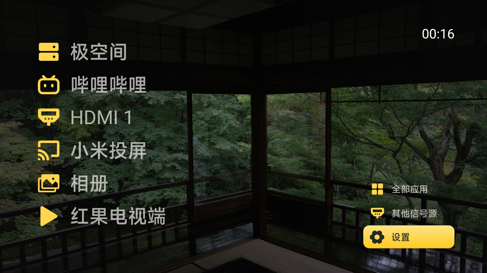
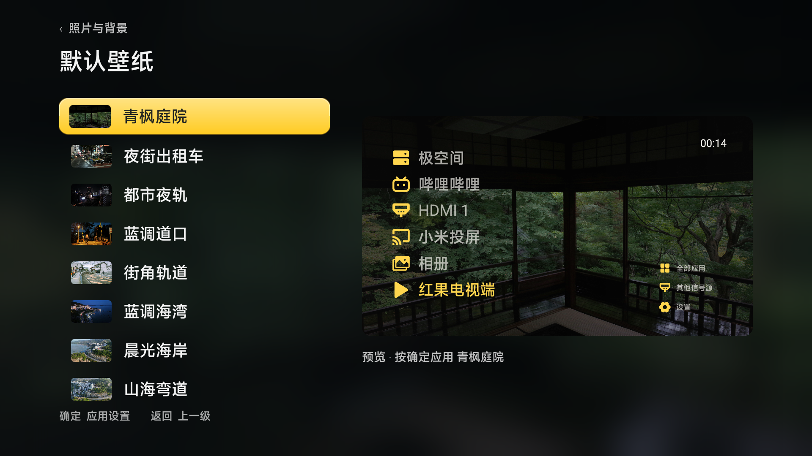
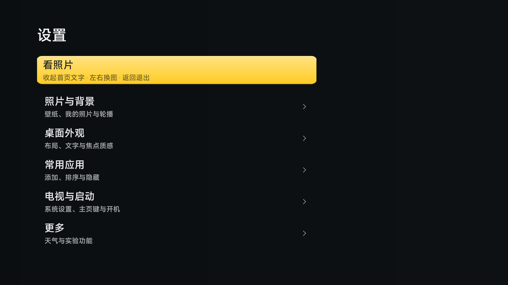

# 煎饼使TV

**把电视首页留给常用应用和自己的照片。**

煎饼使TV 是一款 Android 电视桌面。用遥控器打开常用软件，把旅行、风景和家庭照片放到客厅的大屏幕上。由煎饼使基于 [归藏 guizang-tv](https://github.com/op7418/guizang-tv) 继续开发。

**[下载安装包](https://github.com/jhcina/jianbingshi-tv/releases/download/v0.5.0-preview.4/jianbingshi-tv-0.5.0-preview.4.apk) · [U 盘离线安装包](https://github.com/jhcina/jianbingshi-tv/releases/download/v0.5.0-preview.4/jianbingshi-tv-0.5.0-preview.4-usb.zip) · [安装教程](docs/GETTING-STARTED.md) · [搭配应用](docs/APP-SELECTION.md)**

当前公开版本：**0.5.0-preview.4**。可公开下载体验；兼容范围和可选启动功能见下方说明。

## 让电视更像自己家的东西

这个项目从一台家用小米电视开始：日常打开的只有几个软件，自己拍的照片却很少有机会在大屏幕上看。

我们希望首页既是几个熟悉入口，也是照片可以停留的地方。常用操作清楚可见，设置按用途集中；复杂的设备适配留给需要它的人。目标是把第一次配置讲清楚，让日常使用少一点寻找和解释。

## 你可以用它做什么

| 你想做的事 | 煎饼使TV 的用法 |
| --- | --- |
| 快速打开常用软件 | 添加、排序、隐藏已安装的应用，选择纵向列表或横向 Dock |
| 换上自己的照片 | 导入本机或 U 盘图片；固件没有文件选择器时，使用电脑导入 |
| 坐在沙发上看照片 | “看照片”收起首页文字，左右切换；确定或返回回到桌面 |
| 保留竖幅构图 | 按完整画面展示，深色留边，不强行拉伸铺满 |
| 把个人图库与内置风景分开 | 默认壁纸和“我的壁纸”分别选择、分别轮播；导入照片在本机处理 |
| 看清当前选中项 | 黄黑视觉、大字与明确焦点，统一首页、全部应用和设置的视觉语言 |

基础桌面与本机照片不要求注册账号。内置 15 张壁纸，也可以使用自己的照片；私人照片不上传到本项目的服务，不随公开安装包分发。它不是加密相册，原片仍需自行保留。

## 为什么是这样的设计

电视主要靠遥控器操作，观看距离也比手机远。因此先让人看清“选中了什么、下一步去哪”，再加入适量材质、圆角和动效。

黄色用于提示焦点，深色主体建立轮廓；图标按视觉大小校准，照片留出呼吸空间。深浅主题分别配色，照片背景配遮罩，让界面与照片各自清楚。我们希望质感来自清晰的层次和一致的操作。

## 哪些人适合使用

- 只想保留几个常用入口，希望首页简洁、容易辨认的家庭。
- 喜欢摄影，想在电视上轮播旅行和生活照片的人。
- 愿意先把它作为普通 App 打开体验，再按机型选择是否设置 Home 返回的人。

如果你主要需要海量节目聚合、成熟的全品牌开机接管或完全免配置安装，请先阅读兼容说明。本项目不提供节目库或付费内容解锁。

## 第一次安装

1. 下载 **APK 安装包**。没有必要下载 Source code；它是给开发者的源码。
2. 将 APK 复制到 U 盘，插入电视，通过电视文件管理打开并确认安装。也可下载上方离线包，**先解压**再复制其中的 APK；安装时无需访问 GitHub。
3. 从电视应用列表打开“煎饼使TV”，在设置中选择常用应用和壁纸。

要求 Android 8.0 及以上，并且电视允许安装 APK。U 盘方式取决于厂商固件，不能保证每台电视都有入口；不会插盘自动安装或自动授予主页权限。[完整安装与常见问题](docs/GETTING-STARTED.md)

## 与归藏有什么不同

归藏提供了本项目的大字首页、Dock、应用增删排序、设置预览等基础。本分支围绕**个人照片、常用入口和家庭遥控器操作**继续完善：

- 照片可在安装后导入，无需重新打包桌面；增加独立个人图库和“看照片”模式。
- 导入竖幅保留完整画面；公开壁纸有来源清单，个人素材与发行素材分开。
- 黄黑视觉、工具图标、焦点和二级菜单统一细化。
- 初始入口从本机已安装应用发现，更新保留已有顺序；部分小米固件提供可选适配。

保留上游版权和历史，不把沿用能力称为原创。[详细差异](docs/WHY-JIANBINGSHI-TV.md)

## 红果、直播和其他软件怎么一起用

**先从原作者或官方渠道安装，再到“设置 → 常用应用”添加入口。**煎饼使TV负责桌面，其他软件各自提供服务、账号和更新。

[红果电视端三步安装](docs/APP-INTEGRATION.md) · [播放器与应用选择](docs/APP-SELECTION.md)

截图中的第三方应用是使用者自行安装的。公开包不附带红果等第三方 APK、未知直播源、共享账号或会员解锁；也不承诺安装桌面就能收看某个频道。

## 兼容说明

目前主要实测小米 S Pro 75（MiTV-MFTR0，Android 14，OS3.0.101.0.UFTMATV）。其他品牌、机型与固件仍需验证；Android 版本符合不等于全部功能兼容。

这是桌面 App，不刷写系统，也不删除原桌面。**Home 自动返回和待机恢复属于可选实验功能，默认关闭；完整重启、长期待机和跨品牌启动行为尚未完成验证。**不启用这些功能也能从应用列表打开桌面使用。

个人图库目前最多 30 张，导入副本为 1920×1080；尚无单张删除和导出界面。部分固件没有系统文件选择器，需要电脑导入。请先了解这些限制，再决定是否适合自己的使用方式。

[照片导入](docs/PHOTOS.md) · [启动与撤销](docs/STARTUP.md) · [机型记录](docs/YI-COMPATIBILITY.md) · [反馈问题](https://github.com/jhcina/jianbingshi-tv/issues)

## 来源与版权

代码采用 **MIT**，保留归藏及其他依赖的版权与许可；项目由煎饼使发起，Codex 协助开发，不代表上游或电视厂商官方。

八张原创摄影署名 **乙**，允许在煎饼使TV及保留声明的衍生版本中作为壁纸使用和分发；不授权独立提取作图库、出售素材或无关广告。其余七张 Unsplash 图片保留各自作者与许可，不能改署名乙。个人照片和精修母版不随公开项目分发。

[壁纸与使用范围](docs/WALLPAPERS.md) · [摄影许可](app/src/main/assets/wallpapers/public-defaults/NOTICE.md) · [全部来源](NOTICE.md) · [开发与构建](docs/DEVELOPMENT.md)
