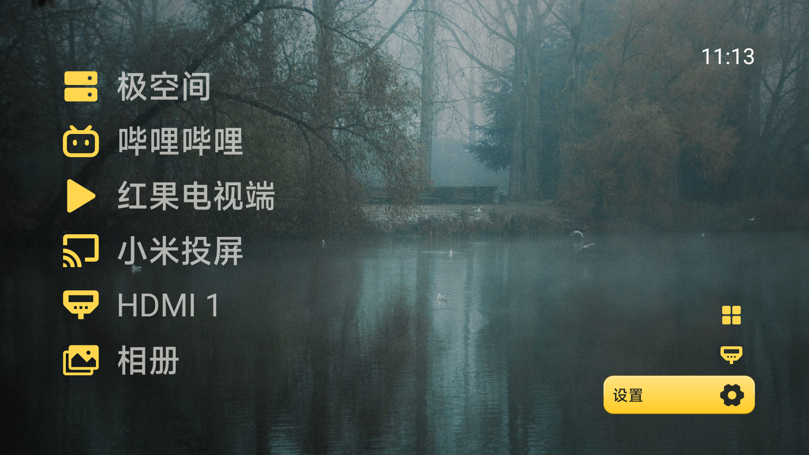

# 煎饼使TV

把电视首页留给常用应用和自己的照片。以 [归藏 guizang-tv](https://github.com/op7418/guizang-tv) 为底座的 Android 电视桌面分支，由煎饼使发起，围绕家庭照片、远距离辨认和明确的设备恢复路径继续开发。

**[下载公开预览 APK](https://github.com/jhcina/jianbingshi-tv/releases/download/v0.5.0-preview.4/jianbingshi-tv-0.5.0-preview.4.apk) · [第一次安装](docs/GETTING-STARTED.md) · [项目差异](docs/WHY-JIANBINGSHI-TV.md) · [照片与版权](docs/WALLPAPERS.md) · [红果安装与整合边界](docs/APP-INTEGRATION.md)**

> 当前推荐下载：**0.5.0-preview.4（预览版，尚非正式稳定版）**。本页图标、15 张默认壁纸与可选待机恢复均在本轮版本中；更新仍需用户下载并安装同签名 APK。完整重启、长期待机与跨品牌兼容尚未全部验收，不能称永久默认桌面。


小米 MFTR0 真实屏幕截图，壁纸摄影：乙。画面中的视频与 NAS 应用由使用者自行安装，不表示本项目附带这些软件、会员或节目。

## 为什么做这个分支

如果你只需要几个常用入口，也想让自己的旅行照片真正出现在客厅，这个分支值得试用。我们的目标是“装好后少折腾”：基础桌面和本机照片不要求账号，应用入口由本机发现，修改顺序会保留；需要额外权限的启动适配单独说明，不混进首次使用。

| 日常场景 | 本分支的处理 |
| --- | --- |
| 电视上换自己的照片 | 从系统文件选择器导入；固件没有选择器时可用电脑导入，无需重新打包 APK |
| 保护私人照片 | 默认图库与“我的壁纸”分别存储、分别轮播；私人照片不进源码和安装包 |
| 把电视当相框 | “看照片”隐藏文字、时钟和桌面入口，左右换图，确定/返回退出；竖幅导入保留完整画面 |
| 坐远一点也好认 | 黄黑主体图标、清楚的焦点；纯深/纯浅主题分别配色，照片背景配遮罩；不叠加白色装饰图标底板 |
| 常用软件与输入源 | 纵向列表或横向 Dock，添加、排序、隐藏；隐藏入口不卸载 App，系统设置收拢到一个入口 |
| 小米指定固件的 Home 返回 | 明确机型、本人授权、可关闭；另有默认关闭的待机恢复实验，不承诺全品牌开机接管 |

### 和归藏、其他桌面怎么选

归藏提供了本项目的大字布局、Dock、设置预览、增删排序、天气与 Codex 等基础。我们保留上游历史和通知，**不将这些基础能力称为本分支首创**。本分支增加运行时照片导入、公开/私有图库隔离、看照片模式、入口初始化、黄黑视觉细化及 MFTR0 指定固件适配。

相较偏重内容推荐的厂商首页，我们把常用入口与个人照片放在前面；相较主要管理应用入口的方案，我们把照片导入、私人隔离和完整画面展示作为一条完整使用路径。这是产品取舍，不代表其他桌面都没有这些能力。需要厂商内容推荐或大量设备的成熟兼容支持时，应按自己的设备和需求比较，不将本项目当成系统固件替代品。[完整差异与下一步](docs/WHY-JIANBINGSHI-TV.md)

## 看一下实际界面


main 的 15 张默认壁纸：八张乙的摄影作品，七张保留原作者署名的 Unsplash 图片。私人婚纱与肖像不随项目分发。


设置分为照片与背景、桌面外观、常用应用、电视与启动、更多；“看照片”是直接操作。更多截图、拍摄版本和使用范围见 [截图说明](docs/screenshots/README.md)。纯图标右对齐修复也已在 MFTR0 查看未聚焦及聚焦状态，并恢复用户原来的图文模式。



纯图标固定在右侧，聚焦名称显示在图标左侧。壁纸“雾湖静晨”：Valentin Blary / Unsplash；该图不包含私人图库或设备通知内容。

## 第一次安装：三步

1. 从上面的公开下载入口取得 `.apk`，**Source code / source.zip 不能安装到电视**。要求 Android 8.0 / API 26 及以上，满足版本条件仍需核对固件。
2. 通过电视支持的 U 盘或文件传输方式安装，按系统正常提示确认；有 ADB 经验可按 [完整指南](docs/GETTING-STARTED.md) 操作。
3. 先作为普通 App 打开。设置 → 常用应用选入口，设置 → 照片与背景选图片；不要求先开无障碍、不要求 root，也不刷写固件。

公开包名 `io.github.jhcina.yitv`，与归藏原版和此前私人测试包分开。安装升级使用同一签名保留数据；不要通过卸载解决签名冲突。导入照片前保留原片，当前尚无图库删除与导出界面。“仅本机”不等于加密相册。

## 红果可以一起用，但没有预装在包里

本项目可以发现、添加并启动用户自己安装的红果电视端。**本仓库与 APK 不附带红果 APK、节目、海报、会员或未知直播源，也不声称是红果官方。**

原客户端由渠道有数独立维护，发行仓库未开放应用源码；当前未核对到覆盖本项目整包捆绑的明确授权。免费使用、欢迎介绍和 GitHub 托管不等于允许我们修改或把它打包再发。现阶段提供 [原版电视下载与安装指引](docs/APP-INTEGRATION.md#红果电视端怎么一起用)，安装后自行加入常用栏。不能把“来源署名了”当作节目传播权或再分发许可。

## 兼容与已知限制

本分支主要实测 **Xiaomi MiTV-MFTR0 / Android 14 / OS3.0.101.0.UFTMATV**。创维、TCL 及其他品牌尚未取得本分支实机验证，不套用小米参数。原桌面、系统设置、投屏和 HDMI 保留。

会话内 Home 返回已检查；可选恢复实验在本人明确授权后，三次短时关屏唤醒通过。完整重启、长期待机和断电仍未完成验收，不能称永久默认桌面。恢复实验涉及额外系统设置写入及通知监听授权，默认关闭，详见 [启动指南](docs/STARTUP.md)、[恢复原理与撤销](docs/STANDBY-RECOVERY.md)、[实测记录](docs/YI-COMPATIBILITY.md)。

天气和 Codex 沿用上游，默认关闭，基础桌面与本机照片可独立使用；“看照片”不是系统屏保，不阻止电视休眠。稳定版缺口见 [发布门槛](docs/RELEASE-READINESS.md)。

## 壁纸版权与来源

**代码采用 MIT；照片另行授权。**八张原创摄影署名为 **乙**，著作权保留，允许在煎饼使TV及保留声明的衍生版本内用作壁纸并随项目分发；不授权独立提取后作为素材出售、收入图库或用于无关广告。详见 [乙摄影作品使用声明](app/src/main/assets/wallpapers/public-defaults/NOTICE.md)。正常使用本桌面没有额外付费要求。

其余七张保持各自摄影师署名及 Unsplash License，不能改署名乙。私人照片、精修母版、设备日志、签名和配对材料均不随公开项目分发。完整素材索引、摘要和许可见 [壁纸说明](docs/WALLPAPERS.md) 与 [NOTICE](NOTICE.md)。

## 开发与核验

直接 fork 自归藏 `312c01119a327f402e68818670a6542f1e643e56`，保留历史、MIT 和第三方通知；基础来源包括 CleanYourTV、CleanFrame 等，具体见 NOTICE。项目由煎饼使提出产品取舍，Codex 协助实现，不代表上游或小米官方。

JDK 17、Gradle 8.9 或兼容版本、Android SDK Platform 34 / Build Tools 34.0.0：

```sh
gradle :app:assembleDebug :app:testDebugUnitTest :app:lintDebug
python -m pip install 'Pillow>=11,<13'
python -m unittest discover -s scripts -p 'test_*.py'
```

构建前校验默认图片 catalog 与 SHA-256，拒绝清单外位图。Debug 构建产物不是维护者签名的公开下载；Release 签名使用 `GUIZANG_KEYSTORE`、`GUIZANG_STORE_PASSWORD`、`GUIZANG_KEY_ALIAS`、`GUIZANG_KEY_PASSWORD`，密钥留在仓库外。Windows 中文路径遇工具链限制时可用空闲盘符映射，不修改已占用盘符。

每次公开版本仍需检查签名、来源、私密素材和源码对应关系；构建通过不能替代设备、长期待机或主观音画验收。反馈请写型号、固件和复现步骤，不公开账号、网络地址、序列号或私人照片。
