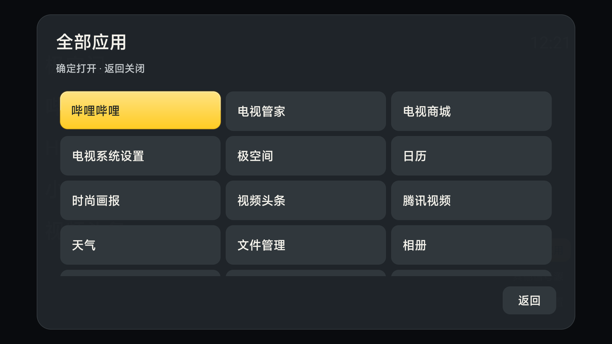
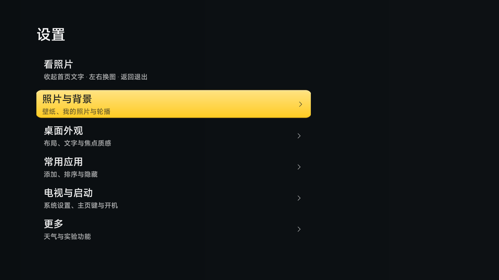

# 煎饼使TV 电视视觉规范

方向：温暖的实体按键与安静的照片背景。借鉴经典拟物界面对层次、材质与按压的重视，不复制锤子图标、界面素材或商标。已有黄色、圆角与照片主角保持。

电视首先要让坐在沙发上的人知道“焦点在哪里、按下会做什么”。参照 Android TV [焦点系统](https://developer.android.com/design/ui/tv/guides/styles/focus-system) 与 [导航指南](https://developer.android.com/training/tv/get-started/navigation)，区别焦点、按下与已应用状态。

- 黄色实体按钮：去掉偏移的实黑投影，改暖黄纵向微渐变、上沿柔光和细深金边。亮边在暗背景上提供分离，深金边在亮背景上界定轮廓；按钮中文字保持深色。无需在主线程分析整张壁纸。
- 首页应用焦点：照片/深色用亮黄色，浅色纯色用深琥珀文字，避免浅底上的浅黄文字。保留用户选定的文字/磨砂焦点设置；照片背景沿用既有局部模糊缓存。
- 二级菜单：全部应用改三列大字面板，操作确认使用同一深灰实体面板和黄色焦点。用稳定暗底与后方压暗隔离复杂照片，不把单纯半透明称为实时磨砂。设置已有离线程模糊背景继续使用。
- 动效：聚焦 150ms 轻抬升 1dp / 1.2% 放大；按下 85ms 微压至 98.5%；面板出场 180ms 由下 8dp 淡入。只动画合成属性，不为焦点每帧重算模糊。系统关闭动画时取消这些过渡，不加常驻闪烁或呼吸光。
- 导航：方向键移动，确定执行，返回关闭当前层；全部应用网格末行不足时焦点仍可达，关闭后恢复入口。系统设置、权限页与信号源由厂商显示，不能保证也不替换其视觉。

验收：深色夜景、明亮照片、浅色纯底与深色纯底；设置与应用网格；快速方向键、返回、确定长按不重复执行；关闭动画；原 Home 返回、照片模式及用户设置保持。以实机截图和录屏为证据，未验证状态必须明确记下。

设置分为照片与背景、桌面外观、常用应用、电视与启动、更多五类，“看照片”为独立动作。升级时一次性从有其他入口的首页列表收拢三个已知系统设置包，原列表保存在应用偏好中；不卸载系统设置，仍可在常用应用中主动加回。返回导航按所属分类逐级返回。

独立静态评审后：淡化三级改为 90% / 78% / 66% 不透明度，保留差异但避免未选中入口难读；看照片移除分类箭头并加分组间距。设置纯色主题不再取私人照片作为模糊底图；应用自有面板与厂商页面的边界保持。

本轮实机画面（preview.3 开发版，纯深色背景，无私人照片）：

## 横向 Dock 候选改进（preview.4，本地构建）

目标是远距离识别与少按几次键。参考 CleanYourTV 的自适应卡片尺寸、焦点和名称配对方式，沿用归藏的 Dock 结构；本轮未复制 CleanYourTV 源码、字体、海报与图标资源。

应用图标优先从本机已安装应用读取并保留原色；HDMI 和缺失应用继续使用现有统一线形图标。彩色品牌图标不再被统一染黄；黄色由选中底板承担，底板上的文字用深色。文字焦点模式仍有黄色轮廓，避免只靠彩色图标判断焦点。

Dock 由应用数和可用宽度决定：四个应用收拢居中，不撑满固定长条；144dp 卡片、64dp 图标、17sp 名称，去掉空副标题占位；超出时保持卡片大小，随焦点水平滚动。首尾不循环，向上去工具区、向下回选中应用的已有导航保持。

动效复用聚焦 150ms、按下 85ms；水平滚动 180ms，并补齐“系统关闭动画”时立即定位。未新增循环装饰动画。当前仅有构建、几何及可达性单元测试证据，尚无本轮实机截图、视觉独立评审或实际动效验收；不得称为已验证的观感提升。
